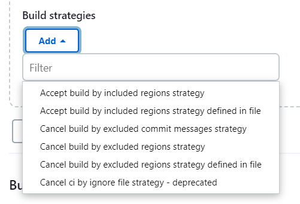
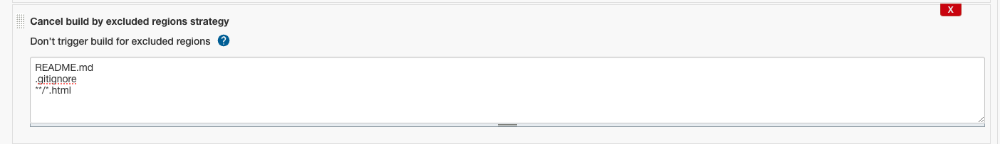
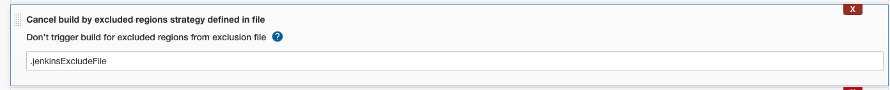

# Multibranch build strategy extension

## Purpose

This plugin provides additional configuration to prevent multibranch projects from triggering new builds based on
include or exclude regions in source repository or existence of a specific phrase in commit message of latest added
commit.

Each region uses [ant pattern matching](https://ant.apache.org/manual/dirtasks.html), and must be separated by a new
line. Any commented line should start by **#**.

Each message uses Java pattern matching based on standard java.util.regex package, and must be separated
by a new line.

### Examples

- Excluding html and jpeg changes to trigger builds
    ```
    src/main/web/**/*.html
    src/main/web/**/*.jpeg
    ```

- Any changes on java files will trigger build
    ```
    src/main/java/**/*.java
    ```

- Prevent to trigger build for commits containing [ci-skip] or [maven-release-plugin] phrases somewhere in commit message
    ```
    .*\[ci\-skip\].*
    .*\[maven\-release\-plugin\].*
    ```

## Setup

Let's say you don't want your CI to run on `README.md`, `.gitignore`, any `.html` file changes or for commits that
contain specific phrase in commit message



1. On multibranch job configuration, in _Branch Sources_ go to _Build Strategies_ section, click **Add** button and
   select one of the available options provided by the plugin, e.g. _Cancel build by excluded regions strategy_ or _Cancel build by excluded commit messages strategy_



2. Fill the textarea with proper exclusions:
   ```
   README.md
   .gitignore
   **/*.html
   ```

This can also be achieved by excluding using a file directly in the repository containing the regions



## Using a separate Git credential

The strategies read changes with Git (fetch and log), using the SCM source's credential. If that credential only works
for the SCM provider's REST API (for example an Atlassian API scoped token with an email username), the Git operations
fail and every change builds.

To use a different credential for those Git operations only, open the multibranch project configuration, add the
**Build strategy Git credential override** property, and set:

- **Git hosts**: the hosts of the repository, separated by commas, for example `bitbucket.org`. The credential is only
  sent to remotes on these hosts; otherwise the SCM source credential is used. List every host the remotes may use:
  Bitbucket Cloud serves Git over SSH on `ssh.bitbucket.org`, so SSH checkouts need
  `bitbucket.org, ssh.bitbucket.org`.
- **Git credential (override)**: a username/password or SSH credential that Git can use against those hosts.

Branch discovery keeps using the SCM source credential. The property is read from the multibranch project itself and
is not inherited from enclosing folders.
